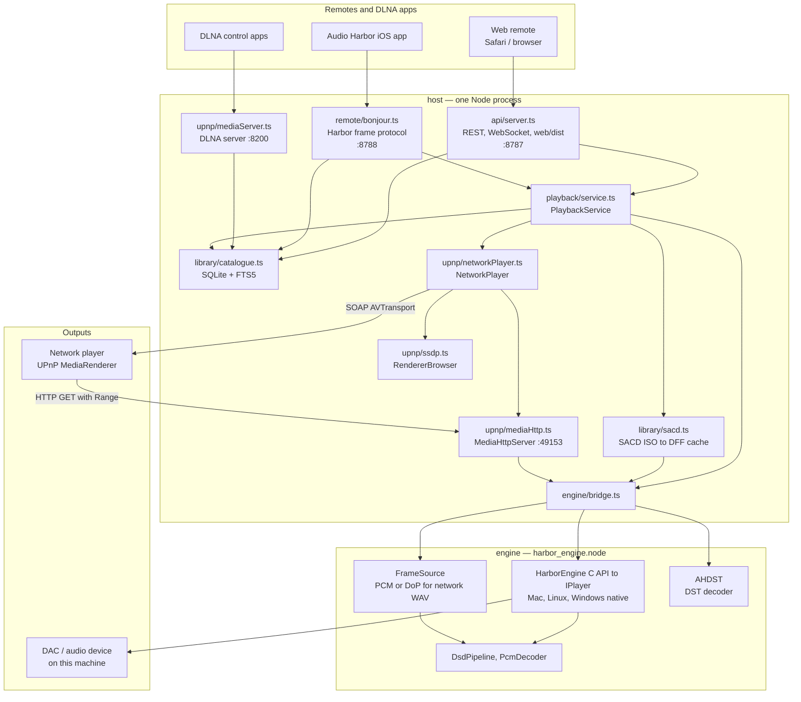
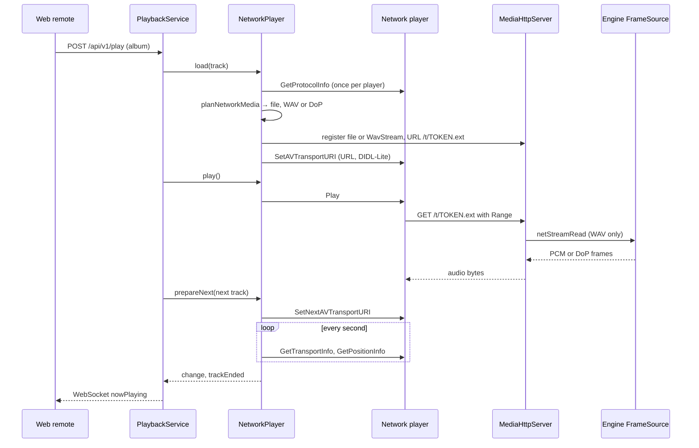

# Audio Harbor Headless — Architecture

Audio Harbor Headless is a music player without a screen. One Node.js process on a Mac, a Linux box (a Raspberry Pi) or Windows plays to a DAC on that machine or to UPnP / DLNA network players. A phone drives it: the web remote in Safari, or the Audio Harbor iOS app over Bonjour. It can also share the library as a DLNA music server.

The sound rules come from [Audio Harbor](https://github.com/petergerov/audio-harbor/blob/main/docs/ARCHITECTURE.md): bit-perfect where the output allows it, no silent resampling, and a badge that says which path the audio takes.

## Stack

| Layer | Tech | Lives in |
|---|---|---|
| Audio engine | C++17 Node-API addon `harbor_engine.node`: native Core Audio / ALSA / WASAPI | `engine/` |
| Plugin rack | `harbor-fx`, a C++17 process next to the addon: CLAP (vendored headers), VST3 (vendored SDK subset, MIT), AU through AudioToolbox on macOS, LV2 through lilv on Linux | `engine/fx/` |
| Host | TypeScript (ES modules) on Node ≥ 22.5: Fastify, `node:sqlite`, music-metadata, bonjour-service, @iarna/toml | `host/` |
| Web remote | Vite + TypeScript, no framework | `web/` |
| Build & release | npm workspaces, cmake-js, GitHub Actions | root, `.github/` |

## Big picture



`PlaybackService` is the hub. It owns the queue and routes every command to the local engine or to the `NetworkPlayer`, by the picked output: a device UID, or `upnp:<UDN>` for a network player.

## Repository layout

```
engine/            C++ addon (harbor_engine.node)
  napi/binding.cpp   N-API surface: transport, devices, DST, network streams
  src/HarborEngine.* C API facade; owns the one IPlayer
  src/PlayerFactory  picks the backend (auto → native)
  src/MacPlayer, LinuxPlayer, WinPlayer, StubPlayer
  src/DsdPipeline.*  DSF / DFF parsing, DoP packing, DSD→PCM FIR, chunked readers
  src/PcmDecoder.*   WAV / FLAC / MP3 (dr_libs), ALAC / AAC via ffmpeg (Linux, Windows)
  src/FrameSource.*  random-access PCM or DoP (network WAV + local PlaybackFeed)
  src/PlaybackFeed.* progressive fill from FrameSource for local players
  src/AHDSTDecoder.* MPEG-4 DST decoder (SACD)
  src/FxClient.*     starts harbor-fx, one request / reply over its pipes, restarts it after a crash
  src/FxStage.*      the rack between a player's PCM and its device: renders ahead, A/B fade
  fx/                harbor-fx: main.cpp (chain, protocol loop), ClapHost, Vst3Host, AuHost, Lv2Host, FxProtocol.h,
                     MainLoop (MacUi.mm, LinuxUi.cpp: event loop and editor windows; MainLoopPlain.cpp on Windows),
                     AuEditor.mm
  fx/test/           TestGain.cpp (test CLAP plugins), StageTest.cpp (fx-stage-test)
  third_party/       dr_flac, dr_mp3, dr_wav, clap (headers), vst3 (SDK hosting subset), json.hpp
host/src/
  index.ts           composition root and CLI: serve | pair | rescan
  api/server.ts      Fastify REST + WebSocket + web remote files
  playback/service.ts  PlaybackService: queue, output routing, gapless
  library/           Catalogue (SQLite), SACD ISO parsing and extraction
  upnp/              network players (control point, media HTTP, planner) and the DLNA server
  remote/            Bonjour remote for the iOS app (browse, settings, artwork), mDNS responder, wire DTOs
  engine/bridge.ts   typed wrapper around the addon; engine events
  drives.ts          USB drives and SMB shares for the library (Linux package, through harbor-drive)
  system.ts          CPU, memory and disk space for Settings → About
  update.ts          Software Update: latest GitHub release, install through harbor-update
  resolution.ts      the rate / bits part of the path badge, and its " · FX"
  rack.ts            the plugin rack: rack.json, plugin scan, chain to harbor-fx, state, meters
  rackPresets.ts     rack presets: save, load (fresh ids), summaries
  access.ts          who may connect: no code (default) or paired devices only
  config.ts, paths.ts, pairing.ts, power.ts, net.ts, types.ts
web/src/             web remote (see web/README.md)
docs/                product page and its screenshots, this document
packaging/linux/     .deb: systemd unit, sudoers, root helpers harbor-drive and harbor-update
packaging/build-plugins.sh   builds the shipped plugins (LSP, CLAP without UI) for Linux and macOS
plugins/             (built, not in git) plugins the packages ship: clap/lsp-plugins.clap, presets/lsp/<plugin id>/, LICENSES/
packaging/macos/     signed .pkg and the menu bar app
config.example.toml  default config, copied on first start
create-package.sh, create-deb.sh, create-macos-pkg.sh, install.sh, start.sh   packaging, setup on a device, launcher
```

## Runtime

One process: `node host/dist/index.js serve` (or `./start.sh`). At start it loads the config, scans the library roots in the background (only changed files; the remote shows the progress), starts searching for network players, applies the stored output, opens the API, claims `audioharbor.local`, and starts the optional DLNA server and the Bonjour remote.

### Ports and discovery

| Port | What | Config |
|---|---|---|
| 8787 TCP | REST API, WebSocket `/api/v1/ws`, the web remote's files | `server.port` |
| 8788 TCP | Bonjour remote for the iOS app (`_audioharbor._tcp`) | `remote.bonjour_port`, `remote.bonjour_enabled` |
| 49153 TCP | Audio for network players (`/t/…`, `/a/…`); any free port when taken | `network.media_port` |
| 8200 TCP | DLNA MediaServer, only with sharing on | `sharing.port`, `sharing.enabled` |
| 1900 UDP | SSDP: finds renderers (M-SEARCH every 30 s, NOTIFY alive / byebye), announces the DLNA server | — |
| 5353 UDP | mDNS: `audioharbor.local` (`-2`, `-3` … when taken), `_http._tcp`, `_audioharbor._tcp`; IPv4 only | `server.local_hostname` |

### Data on disk

All state is under `~/.audio-harbor-headless/`. The music folders are only read.

| File | What | Written by |
|---|---|---|
| `config.toml` | settings; copied from `config.example.toml` on first start, rewritten when a setting changes | `config.ts` |
| `catalogue.sqlite` | tracks, labels, playlists, FTS5 search index (WAL) | `library/catalogue.ts` |
| `artwork/<hash>.jpg` | embedded cover art, by content hash | catalogue scan |
| `pairing.json` | pairing PIN, paired tokens, server id | `pairing.ts` |
| `cache/sacd/*.dff` | SACD tracks extracted as plain DSD (DST decoded) | `library/sacd.ts` |
| `cache/dst-dff/*.dff` | DST-compressed `.dff` decoded to plain DSD | `library/dstDff.ts` |
| `rack.json` | the plugin rack: inserts in order, their switches, pinned knobs and each plugin's saved state; the A/B bypass; the rack presets and which one is loaded | `rack.ts` |
| `plugins.json` | the plugin scan by file and mtime, so only new or changed plugins are described again | `rack.ts` |

On the Linux package the service also has, outside that folder:

| Path | What | Written by |
|---|---|---|
| `/etc/fstab` entries under `/mnt/harbor/<name>` | USB drives and SMB shares set up from the remote, mounted read-only | `harbor-drive` (root, through sudo) |
| `/etc/audio-harbor-headless/<name>.cred` | an SMB share's credentials, root only | `harbor-drive` |
| `/run/audio-harbor-headless/update` | Software Update progress: `state=`, `version=`, `message=`, `at=` | `harbor-update` |

## Engine

```
binding.cpp (N-API)  →  HarborEngine C API (harbor_engine_*)  →  IPlayer
                                                                  ├─ MacPlayer   Core Audio
                                                                  ├─ LinuxPlayer ALSA
                                                                  ├─ WinPlayer   WASAPI
                                                                  └─ StubPlayer  no audio
binding.cpp (N-API)  →  FrameSource, AHDST (no player involved)
```

- **`IPlayer`** (`Player.h`) is the backend contract: devices, output mode, DSD level, load / play / pause / stop / seek, volume, state, events. `HarborEngine.cpp` holds the one player behind a mutex. Switching `output.backend` recreates it and applies device, mode and DSD level again.
- **Backend choice** (`PlayerFactory.cpp`): `auto` and `native` both use the OS stack (Core Audio / ALSA / WASAPI).
- **Output modes** per platform:

  | Mode | Mac (Core Audio) | Linux (ALSA) | Windows (WASAPI) |
  |---|---|---|---|
  | Shared | HAL output on the picked device or the system default | the picked device, or `default` (PipeWire / Pulse) | shared mix format |
  | Exclusive | hog mode on an external DAC, rate follows the file | a `hw:` / `plughw:` device | exclusive |
  | DoP | DoP on an external DAC | DoP on a `hw:` device | DoP over exclusive |

  When the device cannot do the mode, the player falls back and says so in `conversion_badge` (e.g. `Shared (pick hw: device for Exclusive/DoP)`).
- **What the device runs at**: `getState` also reports the stream rate, the device rate and bits, and whether DoP is on. MacPlayer reads the device's nominal rate and the physical format of its first output stream; LinuxPlayer the `hw:` rate and significant bits, or behind `plughw` what the card runs at (`/proc/asound/card*/pcm*p/sub*/hw_params`). WinPlayer reports none. `resolution.ts` turns that into the badge the remotes show, e.g. `96 kHz / 24-bit · Exclusive` or `44.1 → 48 kHz / 24-bit · Shared`.
- **Local decoding**: MacPlayer, LinuxPlayer and WinPlayer open a `FrameSource` through `PlaybackFeed` and fill PCM / DoP on a worker; playback starts after the first quantum (the buffer still grows to the full track). DSD becomes DoP or ~88.2 kHz PCM with `dsd_pcm_level` (0 / +3 / +6 dB).
- **DSD→PCM**: multi-stage linear-phase FIR (`DsdPipeline.cpp`), DSD rate / 32, / 64 or / 128 → 88.2 kHz, one more 2:1 stage for 44.1 kHz (Wi‑Fi).
- **FrameSource**: random access by frame (`readFloat` / `readDop` / `readPacked`), so the host can answer any `Range` request for network WAV and (soon) feed local playback without loading the whole file. Sources: `DsdSource` (DSD→PCM through `DsdPcmReader`), `DopSource` (DoP at DSD rate / 16), FLAC, WAV, MP3, AIFF, ExtAudioFile on macOS, and a decode-to-memory fallback. `DsdByteReader` reads DSF / DFF in 64 KiB chunks per channel for both DSD sources. `DsdPcmReader` pre-rolls after a jump, so a seek gives the same samples as playing through.
- **DST**: the host feeds DST frames from an SACD ISO or a DST-compressed `.dff` through `dstBegin` / `dstDecodeFrame` / `dstEnd` and writes plain DSD into the DFF cache (`cache/sacd`, `cache/dst-dff`).
- **Plugin rack**: see [Plugin rack](#plugin-rack).
- **Threads and events**: players run their own audio threads and report `state` and `ended` through an N-API ThreadSafeFunction; `bridge.ts` re-emits them as `engineEvents`. Network stream open and read run as AsyncWorkers, so a renderer's read never blocks the event loop. `load` itself runs on the calling thread.

## Plugin rack

The plugins the user already has — CLAP and VST3 on macOS and Linux, AU on macOS, LV2 on Linux (LSP, x42, Calf, ZAM from apt, on the Pi too) — run in **`harbor-fx`**, a process of their own next to `harbor_engine.node`. A plugin that crashes takes only `harbor-fx` down; the music goes on dry and the rack comes back with its chain. Network players get the music through the same rack; the iOS app switches it and loads rack presets (Bonjour protocol 4). On a Mac or a Linux desktop the plugins' own editors open on the host's screen. Own modules are the next stage ([implementation_plan.md](../implementation_plan.md#plugin-rack-fremde-plugins)).

```
web remote ──REST──▶ rack.ts ──fxRequest(JSON)──▶ FxClient ──stdin/stdout──▶ harbor-fx ─┬─ ClapHost (dlopen .clap)
                                                     ▲                                  ├─ Vst3Host (bundle / .so)
                                                     │                                  ├─ AuHost   (AudioToolbox, macOS)
                                                     │                                  └─ Lv2Host  (lilv)
player ◀── FxStage.read() ◀── ring ◀── worker ───────┘ Process(block)
```

- **Protocol** (`fx/FxProtocol.h`): frames `[u32 length][u8 type][body]`; the engine sends one request and reads one reply. `Prepare` (rate, channels, max block), `Process` (float32 interleaved), `Reset`, `Control` (JSON: `setChain`, `setBypass`, `params` — stepped ones with their `options` and the plugin's text for each —, `setParam` with a `value` or a `text` the plugin reads, `values` for a few, `getState(s)`, `setState` into a running unit, `resetParams` to the defaults, `presets` and `loadPreset` for the plugin's own presets, `openEditor` / `closeEditor`, `meters`, `inserts` — each with `editor` (it can open here) and `editorOpen`). Read-only parameters (an LV2 plugin's meters) come flagged `readOnly`. Every reply starts with the chain's latency and flags (engaged = units loaded; processing = one in circuit). harbor-fx moves fd 1 to stderr at start, so a plugin's `printf` cannot break a frame.
- **harbor-fx**: a `Rack` of inserts. `setChain` keeps running units whose id, file and plugin id match (the live unit is the truth; the host's saved state is applied only to new units). Plugins are created and activated on the main thread and processed on an `AudioThread` (CLAP's thread rules). A bypassed insert is replaced by a delay of its latency, so the chain's latency does not move. Only stereo effects (2 in, 2 out on the main ports) are taken; other ports get silence. CLAP: every audio port gets a buffer (Pro-Q 4 has a sidechain), parameter changes go in as events or through `flush`, state through `clap.state`. VST3 (`Vst3Host.cpp`, macOS and Linux): the SDK's interfaces and a few hosting helpers are vendored (`third_party/vst3`, MIT, no VSTGUI); the module loader is our own (macOS `CFBundle` + `bundleEntry`, Linux `Contents/<arch>-linux/<name>.so` + `ModuleEntry`), and a module stays loaded for the life of harbor-fx. Component and controller (one object or two, joined through `IConnectionPoint`) are set to a stereo main bus, other buses inactive; parameter changes go to the next `process` as `ParameterChanges`, outputs back to the controller; values are normalized 0–1, stepped ones (≤ 64 steps) with their names; text both ways through the controller. State: component and controller in one blob. AU (`AuHost.cpp`, macOS): every effect component (`aufx`, `aumf`) by its type-subtype-manufacturer id; AUv2 in-process, AUv3 app extensions out of process (`AudioComponentInstantiate`). Input through a render callback, `AudioUnitRender` into our buffers; parameters by clump (as groups), names for indexed and boolean ones, the plugin's text both ways where it has one (else the unit's symbol, seconds below 1 as ms), latency from `kAudioUnitProperty_Latency`, state as the `ClassInfo` property list. LV2: instantiated when the rate is known (state kept across a rate change), control ports as parameters (`lv2:enabled` is the bypass switch), atom ports sized by `rsz:minimumSize`, the worker run at once, state through lilv.
- **Main thread and editors** (`MainLoop.h`): on a Mac with a logged-in screen (`CGSessionCopyCurrentDictionary`, on console) harbor-fx runs `NSApplication` (accessory: no Dock icon) on the process's real main thread and reads the protocol on another; each message is handed to the main thread through the run loop (`CFRunLoopPerformBlock`, not the main dispatch queue, so a plugin waiting for an answer the system sends there — an AUv3 extension starting — gets it) and its reply goes out before the next is read. Plugins thus still see one main thread, and a timer (~30 Hz) runs the callbacks they ask for between messages. On a Linux desktop (`DISPLAY` set; `LinuxUi.cpp`) the main thread runs a `poll()` loop over the hand-over pipe, the X11 connection, the plugins' file descriptors and timers (`mainloop::addTimer` / `addFd`), with libX11 opened at run time (`dlopen`), so a Pi without a desktop needs none of it. Without a screen (and on Windows) the protocol loop is the main thread, as before. `openEditor` puts the plugin's editor in an `NSWindow` of its own (`MacUi.mm`), brought to the front: CLAP through `clap.gui` (Cocoa, embedded; `request_resize` resizes the window), VST3 through the controller's `IPlugView` in an `NSView` with an `IPlugFrame` (`resizeView`), its `performEdit`s going to the processor with the next block; On Linux the window is an X11 top-level window (fixed to the editor's size, `WM_DELETE_WINDOW` noticed): CLAP embeds with `CLAP_WINDOW_API_X11` and gets `timer-support` and `posix-fd-support` from the loop; VST3 with `kPlatformTypeX11EmbedWindowID`, its `IPlugFrame` also answering `Linux::IRunLoop` (event handlers, timers); LV2 X11 UIs (`ui:X11UI`) through a small UI host — the UI library loaded, `ui:parent`, `ui:resize`, `ui:idleInterface` (~30 Hz), `instance-access`, `data-access`, controls both ways (`port_event` for every control that changed, writes to the plugin's controls) and atoms both ways (the UI's into the plugin's atom inputs before a block, the plugin's atom outputs to the UI after it; LSP's spectrum shows). AU through `AuEditor.mm` — the extension's view controller (AUv3, `kAudioUnitProperty_RequestViewController`), else the unit's Cocoa view (AUv2), else Core Audio Kit's generic view of its parameters. A window closed on the screen closes the editor at the next idle; an insert removed closes its window first. AUv3 instantiation waits with the run loop turning, so extensions also start in the `--describe` scan.
- **Plugin presets** (`FxPlugin::presets()` / `loadPreset()`, ids opaque to the host): AU — the unit's factory presets (`kAudioUnitProperty_FactoryPresets`, loaded as `PresentPreset`), then `.aupreset` files in `~/Library` and `/Library/Audio/Presets/<vendor>/<name>/` (a ClassInfo plist, loaded like saved state). VST3 — the root unit's program list when a program-change parameter selects from it, then `.vstpreset` files in the standard preset folders (`<root>/<vendor>/<plugin>/`; macOS `~/Library` and `/Library/Audio/Presets`, Linux `~/.vst3/presets`, `/usr/share` and `/usr/local/share/vst3/presets`) whose class id is this plugin's; the file's `Comp` / `Cont` chunks go in as saved state. CLAP — `ClapPresets.cpp` runs the file's preset-discovery providers (`clap.preset-discovery-factory/2`, or its draft), walks their locations and keeps the presets naming this plugin (factory content first, grouped by folder), and loads one through `clap.preset-load`. LSP's CLAP build has none: `LspPresets.cpp` reads LSP's own `.preset` files (`port = value`; shipped under `plugins/presets/lsp/<plugin id>/`), sets every parameter to its default, then each port through the parameter LSP's wrapper gives it (the port id hashed as in lsp-plugin-fw) — switches and lists by index, the rest through the plugin's own text parser (`55.0` Hz, `2.63` dB). LV2 — the `pset:Preset`s related to the plugin (its bundle's, `~/.lv2`), loaded with `lilv_state_new_from_world` like saved state, so also before the plugin is instantiated.
- **Meters**: harbor-fx measures every insert itself — peak in and out per block, held and falling (0.3 s) — since a plugin need not report anything (LSP's CLAP builds expose no meters). Out minus in is the gain change: a compressor's or limiter's reduction, makeup included. Rendered ahead, so it leads what is heard by the lookahead.
- **FxClient** (engine): starts `harbor-fx` on the first request that needs it (none for an empty rack), replays the last chain and format after a restart, and kills it when a reply takes longer than 10 s. Three crashes within 30 s stop the rack until the host sends a new chain. Events go to the host as `fx` (`running`, `error`, `stopped`).
- **FxStage** (engine): the player's track is decoded into memory (`PlaybackFeed`), so the rack need not keep pace in real time — a worker renders ~200 ms ahead of the playhead through harbor-fx into a ring, and the device thread reads the ring without locks. A jump in position is a request the worker answers (prepare, refill). The plugins' latency is compensated: the first `latency` frames after a start are dropped and the end is fed silence, so ring frame k is processed dry frame k. **A/B** fades between the ring and the dry PCM in 10 ms; the plugins keep running, so switching back is instant. A new latency or a restarted harbor-fx starts the ring over at the playhead. With no inserts `read()` hands out the PCM untouched — bit-perfect as before.
- **Live**: a parameter change calls `fxTouch` (engine `FxStage::touch`); for the next 3 s the worker keeps only ~50 ms ahead in 512-frame blocks, so later moves are heard within ~50 ms. Nothing already rendered is thrown away — rewinding plugins would click — so the first move still waits out the ring.
- **Network players**: `FxFrameSource` (engine) wraps a network stream's `FrameSource` when the host opens it with `fx` (`netStreamOpen`): the file's PCM through the same harbor-fx chain, as 24-bit (plugins may lift a 16-bit file's peaks; clipped at full scale). Read in order, the chain runs on; a jump (a `Range` request, a seek, another stream or the local stage taking the chain) prepares it again and feeds half a second before the position, its output dropped with the latency, so frame k out is processed frame k. Whole rack bypassed, empty or gone: the file's frames untouched. `FxClient::preparations()` counts prepares, so the local stage and a stream each notice when the other had the chain.
- **Players**: MacPlayer and LinuxPlayer read through `FxStage` when it is engaged; with inserts in the rack, DSD loads as PCM instead of DoP (the next track — as in the Mac app). WinPlayer is not wired yet; FxClient refuses to start on Windows.
- **Shipped plugins** (Linux, macOS): `packaging/build-plugins.sh` downloads the LSP Plugins source release (pinned version and sha256), builds it with `FEATURES="clap"` — no UI, so only `libsndfile` on Linux instead of X11 / OpenGL / cairo, and only system frameworks on macOS — and puts `lsp-plugins.clap` and its licence under `plugins/`. LSP's presets (made for its UI) go to `plugins/presets/lsp/<plugin id>/`: each plugin's metadata names its preset folder (`res/main/presets/…`); whole `.preset` files only (Room Builder's `.patch` files need LSP's resources). The release workflow runs it before packaging (macOS: `brew install make` for GNU make); `create-package.sh` stages `plugins/` with the rest; `create-macos-pkg.sh` signs the file like every other Mach-O in the payload; the `.deb` depends on `libsndfile1`. At start `rack.ts` puts `<app>/plugins/clap` first on `CLAP_PATH` (harbor-fx inherits it) and gives five of them a `role` — Graphic EQ, Parametric EQ, Mastering Compressor, Mastering Limiter, Loudness Compensation — which the picker lists first.
- **Presets** (`rackPresets.ts`, kept in `rack.json`): the whole rack under a name — inserts, order, switches, pinned knobs, each plugin's state. Saving reads the states back from harbor-fx first; loading gives the inserts new ids, so harbor-fx creates the units and restores the saved states into them. The rack remembers which preset it came from and whether it changed since (`activePreset`, `edited`).
- **Host** (`rack.ts`): `rack.json`, the plugin scan — `harbor-fx --list` names the files (and AUs, which it marks `describe`); then `--describe <format> <path-or-id>`, six at a time, each in its own process with a 20 s timeout (a plugin that crashes or waits for a licence window is left out with its reason), only for entries whose stamp (file mtime, or an AU's version) changed; cached in `plugins.json`. The scan starts in the background when the host starts (so Add Plugin opens on a finished list); a new harbor-fx build (by its file's time, `plugins.json` `fx`) tries the plugins that failed once more. While an editor is open on the host's screen, the host reads the inserts and settings back every 1.5 s, so what is turned there is kept and reaches the remotes, and a window closed there is noticed. REST `/api/v1/rack…`, the `rack` WebSocket message. Settings are read back from harbor-fx 1.5 s after a knob moves, written to `rack.json` and sent as the chain the engine replays after a crash. On `fx` `running:false` the host sends the chain again, which starts harbor-fx anew.
- **Badge**: `rackSuffix` adds ` · FX` while plugins shape the sound, ` · FX bypassed` while the rack only passes it on. The rack's own path label follows the Mac app: `Exclusive · FX`, `Shared · FX`, `Network · FX`, `Bypassed`, `Bit-perfect`. A network track through the rack shows `PCM 44.1 kHz / 24-bit · Network · FX` (` · FX bypassed` while the rack is out).

## Host

`index.ts` wires everything; nothing else constructs services. `PlaybackService` gets the catalogue, config access, the renderer browser and the network player through its constructor.

| Module | Job |
|---|---|
| `api/server.ts` | Fastify: REST under `/api/v1`, WebSocket `/api/v1/ws` (pushes `nowPlaying`, `queue`, `settings`, `scan` and `rack`), the web remote from `web/dist`. `GET` / `PUT /api/v1/settings` read and change the same Settings snapshot the iOS app gets. With `remote.require_pairing` on, every API route except health and pairing needs a token (`Authorization: Bearer` or `?token=`); off (the default), none does. `GET` / `PUT /api/v1/access` read and switch it. |
| `playback/service.ts` | Queue (album, artist, folder, playlist or label, with that source for the remotes), repeat, transport, output pick, DSD→PCM level. Routes to the engine or the `NetworkPlayer`. A tap on the track already loaded pauses or resumes it; a pause while a track loads keeps it from starting. Moving between this host and a network player, or changing what DSD becomes on one, reloads the current track at the same position. Emits `nowPlaying`, `queue` and `settings`. |
| `library/catalogue.ts` | SQLite catalogue: `tracks`, `labels`, `playlists`, `tracks_fts`. A scan walks the roots, skips unchanged files by mtime, reads tags with music-metadata and stores cover art by hash. A root that is missing, or empty while it still has tracks (an unmounted share), is skipped, so its tracks, labels and playlist entries stay. A track's identity is its absolute path; an SACD track is `disc.iso#sacd/N`. Playlists and labels are sets of paths. |
| `library/sacd.ts` | Scarlet Book: reads the TOC into catalogue tracks; extracts a track to an uncompressed DFF on first play (DST decoded by the engine), asynchronously with yields, one extraction per file; prefetches the next tracks. |
| `upnp/*` (network players) | SSDP discovery, SOAP control, media HTTP, the media planner and `NetworkPlayer` — see below. |
| `upnp/mediaServer.ts`, `upnp/sharing.ts` | DLNA MediaServer: device description, ContentDirectory Browse / Search, WAV transcoding for DSD, files under the library roots by `Range`, SSDP announcements. `Sharing` starts and stops it while the host runs. |
| `remote/bonjour.ts` | The Audio Harbor iOS app's protocol: `[u32 length][kind][payload]` frames, JSON envelopes v4 (hello / pair, subscribe to `nowPlaying` / `queue` / `settings` / `rack`, transport, playSelection, browse, search, trackOptions, editTrack, getSettings / setSettings, getRack / setRack / loadRackPreset) and binary artwork. `browse.ts` pages and filters the library, `settings.ts` builds and applies the Settings snapshot, `artwork.ts` scales covers, `wire.ts` maps snapshots to its DTOs. Folder IDs are `rootUUID/rel/path`, never host paths. Version 3 for now: protocol 4 (Mac app 1.1.3) adds the plugin rack (`getRack` / `setRack` / `loadRackPreset`, topic `rack`), and the iOS app asks for it only from a version-4 host, so its rack dial stays hidden until Headless answers those (plugin rack, stage 3). Unknown topics in a subscribe are dropped; unknown requests get `unsupported`. |
| `remote/rack.ts` | Protocol 4's rack, by the Mac app's rules: the snapshot (path, inserts with `vendor · format`, presets, the one loading), the whole rack or one insert in or out (not an insert while the rack is bypassed), a rack preset loaded without waiting — the `rack` topic follows as it loads. Editing stays with the web remote. |
| `remote/mdns.ts` | One mDNS responder (bonjour-service): probes and claims `audioharbor.local`, publishes `_http._tcp` and `_audioharbor._tcp`, answers AAAA with NSEC (IPv4 only), follows address changes, says goodbye on exit. |
| `access.ts` | `AccessPolicy`: who may connect. Without the code (`remote.require_pairing = false`, the default) every request, WebSocket and Bonjour session goes through; the iOS app is sent `paired` with one shared token right after the server's hello, so it never shows its code screen. Switching the code on keeps the caller (it gets a token), revokes every other token and the shared one, and makes a new PIN. A config from before the setting, on a host with paired devices, is written with the code on. |
| `pairing.ts` | The token store: six-digit PIN → random token (`POST /api/v1/pair` or the Bonjour hello). The PIN changes after each pairing; five wrong PINs in a row pause pairing for a minute. Web and iOS share the tokens. |
| `drives.ts` | Lists disks (`lsblk`) and Harbor's fstab entries, and sets up, ejects or removes a USB drive or SMB share through the root helper `harbor-drive` (`sudo -n`, group `harbor-drives`; the SMB password goes on stdin). Only on Linux with the package's helper; elsewhere the remote hides it. |
| `system.ts` | CPU model, cores and load, memory (and what Harbor uses), free space on the disks that hold Harbor's data and the library — Settings → About. |
| `update.ts` | Software Update: asks GitHub for the latest release (cached an hour), compares versions, and on the `.deb` starts `harbor-update install <tag>`. The helper runs as a transient systemd unit, so the service restart during `apt install` does not stop it; it takes only this repo's releases, checks the `.sha256`, package name, architecture and that the version is newer. The remote follows the status file and reloads when the host comes back with the new version. |
| `rack.ts` | The plugin rack — see [Plugin rack](#plugin-rack). |
| `config.ts` | Loads `config.toml`, normalizes every value, writes it back on change. |
| `power.ts` | `KeepAwake`: `caffeinate` (macOS) or `systemd-inhibit` (Linux) while a network player streams. |

### Network players

A network player is an output like a DAC: the host is the control point and serves the audio; the player pulls it over HTTP. Same design as Audio Harbor's [UPNP.md](https://github.com/petergerov/audio-harbor/blob/main/docs/UPNP.md).

| Part | Where | Job |
|---|---|---|
| Discovery | `ssdp.ts` `RendererBrowser` | M-SEARCH every 30 s per interface, NOTIFY alive / byebye, `max-age` expiry, device description; keeps renderers with AVTransport. Output UID `upnp:<UDN>`. |
| Control | `controlPoint.ts`, `httpClient.ts`, `xml.ts` | SOAP: AVTransport (SetAVTransportURI, SetNextAVTransportURI, Play, Pause, Stop, Seek, GetTransportInfo, GetPositionInfo), RenderingControl volume, ConnectionManager GetProtocolInfo. |
| What is sent | `networkMedia.ts` `planNetworkMedia` | The file untouched when the player lists its type, else WAV. DSD by the player's mode (`network.dsd_modes`): Auto sends the DSF / DFF untouched when the player lists DSD, else PCM; PCM = 88.2 kHz / 24-bit; DoP = 24-bit WAV at DSD rate / 16. `network_stream = "wifi"` makes DSD 44.1 kHz / 16-bit PCM in every mode. With plugins loaded in the rack (`NetworkRack.engaged()`, decided per track) every track is a 24-bit WAV through them (`fx`), DSD as PCM. |
| Serving | `mediaHttp.ts` `MediaHttpServer`, `networkMedia.ts` `WavStream` | Opaque tokens `/t/<n>-<hex>.<ext>` and `/a/` for artwork; `Range`, `HEAD`, DLNA headers. WAV is made on the fly with a computed `Content-Length`, so a `Range` maps to a frame and seeking works. The URL host is this machine's address toward the player. |
| Session | `networkPlayer.ts` `NetworkPlayer` | Load, play, pause (Stop as fallback), seek, volume (coalesced). Polls position every second, tells a track's end from a stop on the device, follows the player leaving and coming back. Arms the next track with SetNextAVTransportURI for gapless (remembered per player when refused). While DSD goes out as DoP the volume is left alone. |



## Web remote

A single-page app served by the host, mobile first, desktop layout on wide screens (`min-width: 700px`). Tabs are **Deck · Catalogue · Settings**. Deck is a Harbor stage (Turntable / Reel-to-Reel) with cover chip; on desktop, Up Next sits in a right rail like the macOS app, and the bottom player is hidden while Deck is open. Phone and desktop Deck are sized to fit the viewport without scrolling. Layers depend inward only — `ui` → `services` → `state` / `api` → `core` — and nothing below `ui` touches the DOM. `main.ts` is the composition root; views get an `AppContext` of interfaces; state is one `Store<AppState>`; `chromeFor` in `selectors.ts` decides mini player / now-bar; live player state follows the `PlayerMarkup` contract, so lists keep their scroll position while tracks change. The rules and the folder map are in [web/README.md](../web/README.md).

The web remote talks only to the REST API and the WebSocket. Pairing stores the token in `localStorage` (`harbor.token`).

## Flows

**Play an album on a local DAC.** The web remote posts `/api/v1/play` with the album id. `PlaybackService` queues the album's tracks, resolves an SACD track to its cached DFF, and calls `engineLoad` and `enginePlay`. The engine's `state` and `ended` events come back through `engineEvents`. On `ended` the service loads the next track, and every change goes out over the WebSocket as `nowPlaying` / `queue`.

**Play to a network player.** As in the sequence above. A failed or lost player puts the session into `failed` with a message; once the player is back, Play loads the track again where it was.

**Change the output.** `PUT /api/v1/output` stores device, mode, backend, network stream and the player's DSD mode in `config.toml`. Moving between this host and a network player — or, on the same player, changing what DSD becomes — reloads the current track at the same position, playing if it was.

**Pair.** Only with the code on (`remote.require_pairing`); without it, remotes connect at once and the web remote keeps no token. The host prints the PIN at start (`harbor pair` shows it again, `--rotate` makes a new one). While nothing is paired yet, `GET /api/v1/pair/setup` hands the PIN to the first remote, so a host without a screen needs no terminal; later a paired remote shows it under Settings → About. The web remote posts it to `/api/v1/pair`; the iOS app sends it in its hello. Both get a token for all later requests.

**Change the rack.** The web remote posts `/api/v1/rack/inserts` with a plugin from `/api/v1/rack/plugins`. `rack.ts` adds it to `rack.json` and sends the whole chain to harbor-fx (`setChain` through `fxRequest`), which loads the new unit and keeps the others; the engine learns from the reply that the rack is engaged. The playing track's `FxStage` asks the worker to start at the playhead, and the next blocks come back processed. Knobs (`PUT …/params/:param`) go straight to harbor-fx and are heard ~200 ms later; A/B (`PUT /api/v1/rack/bypass`) fades at once.

**Update (Linux package).** Settings → About → Install posts `/api/v1/update` with the tag. `update.ts` runs `harbor-update install` through sudo; the helper downloads the release `.deb` for this CPU, checks it and installs it with apt, which restarts the service. The remote polls `/api/v1/update`, shows the steps, and reloads once the host answers with the new version.

## Build, run, release

| Command | Does |
|---|---|
| `npm run build:engine` | `engine/scripts/build.js` → cmake-js (or plain CMake): `engine/build/Release/harbor_engine.node` (native Core Audio / ALSA / WASAPI) and `harbor-fx` beside it; LV2 when `pkg-config` finds `lilv-0` (Linux). |
| `npm run test:fx -w @harbor/engine` | `fx-stage-test`: the rack end to end without a device, against the test plugins — see Testing |
| `npm run build:web` | Vite → `web/dist` (served by the host; restart the host after a rebuild) |
| `npm run build:host` | `tsc` → `host/dist` |
| `npm run serve` | build all, then `harbor serve` |
| `npm run package:prebuilt` | build, prune dev dependencies, `create-package.sh --prebuilt` → `dist/packages/audio-harbor-headless-<version>-<platform>.tar.gz` with Node 22 under `runtime/` |
| `npm run package:deb` / `package:macos` | the `.deb` (`create-deb.sh`, on Linux) / the signed `.pkg` (`create-macos-pkg.sh`, see [packaging/macos/README.md](../packaging/macos/README.md)) |

- **Release** (`.github/workflows/release-packages.yml`): started by hand with a tag and the platforms to build — darwin-arm64, darwin-x64, linux-arm64, linux-x64 by default, win32-x64 when ticked. Builds the `.tar.gz` / `.zip`, the signed and notarized `.pkg` on macOS and the `.deb` on Linux, with `.sha256` checksums, and attaches them and `install-linux.sh` to a GitHub Release. The version comes from `package.json`.
- **On a device**: `install.sh` installs build dependencies and builds from source (Raspberry Pi / Linux); `start.sh` picks the bundled Node, checks the addon's ABI, clears the macOS quarantine flag, creates the config on first start and runs `serve`, `pair` or `rescan`.

## Testing

One automated test so far; everything else is checked by hand:

- **Plugin rack**: `npm run test:fx -w @harbor/engine` runs `fx-stage-test` against `harbor-fx` and the test plugins (`build/test-plugins/harbor-test-gain.clap`: a gain and a 64-frame delay): empty rack untouched, gain from frame 0 and after a seek, latency compensated to the frame, A/B fade without a step, harbor-fx killed mid-play and back. Plugin editors: on the Mac by opening and closing them; on Linux in a container with Xvfb — LSP built with its UI as CLAP and VST3, LSP and x42 LV2 from apt — a knob turned with `xdotool` (mouse wheel) in each format reaches the plugin. Real plugins: CLAP, VST3 and AU on the Mac (`CLAP_PATH` / `VST3_PATH` add folders; FabFilter Pro-Q 4 / Pro-L 2, Analog Obsession BritChannel, Apple AUPeakLimiter, a full scan of ~1,000 installed plugins); LV2 in an `ubuntu:24.04` container with `liblilv-dev`, `lsp-plugins-lv2` and `x42-plugins`; VST3 on Linux (arm64, Debian bookworm) with LSP built as `FEATURES="vst3"`.
- **Network players**: the renderer simulator in Audio Harbor (`tools/upnp`, `upnp-renderer-sim --silent`, optional `--sink-file`, `--no-next`, `--max-rate`). Run the host with a scratch `HOME`, so `~/.audio-harbor-headless` stays untouched.
- **Network stream through the rack**: part of `npm run test:fx` — `fx/test/net-fx-test.js` reads a WAV through the test plugins in order, after jumps and to the end, and checks every frame is half the dry one, latency compensated; bypassed and with an empty rack the file comes out untouched.
- **Engine streams**: small Node scripts that open `netStreamOpen` / `netStreamRead` and compare jumps against continuous reads, or DoP bytes against the file.
- **Web remote**: in a browser at phone and desktop widths.
- **Linux package and Software Update**: build the `.deb` in a `debian:bookworm` container and install it in a container with systemd (see [LINUX.md](LINUX.md#testing-locally-docker)).

## Where to change what

| To … | Change |
|---|---|
| add an API route | `host/src/api/server.ts`, its client in `web/src/api/*Api.ts`, types in both `types.ts` |
| add a config key | `HarborConfig` in `host/src/types.ts`, load / save in `config.ts`, `config.example.toml`, README |
| support a format on network players | `PASSTHROUGH` / planner in `host/src/upnp/networkMedia.ts`; a decoder in `engine/src/FrameSource.cpp` when it must become WAV |
| add an output backend | an `IPlayer` in `engine/src/`, `PlayerFactory.cpp`, `CMakeLists.txt` |
| add a web tab or settings pane | the view plus one entry in `web/src/ui/views/registry.ts` or `PANES` in `settingsView.ts` |
| speak a new iOS remote command | `host/src/remote/bonjour.ts` (and `wire.ts` for DTOs) |
| host another plugin format | a `…Host.cpp` in `engine/fx/` with list / describe / load (`FxPlugin.h`), its branch in `fx/main.cpp`, `CMakeLists.txt` |
| change what the rack does with audio | `engine/src/FxStage.cpp` (ahead-rendering, A/B), `fx/main.cpp` (`Rack::process`) |
| let the service do something as root (Linux) | a helper in `packaging/linux/`, its line in `packaging/linux/sudoers`, installed by `create-deb.sh` |
